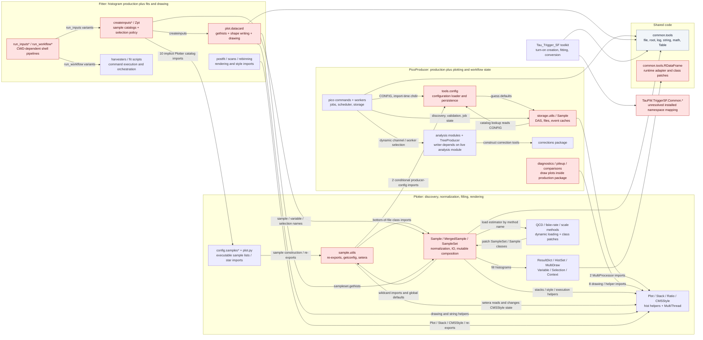
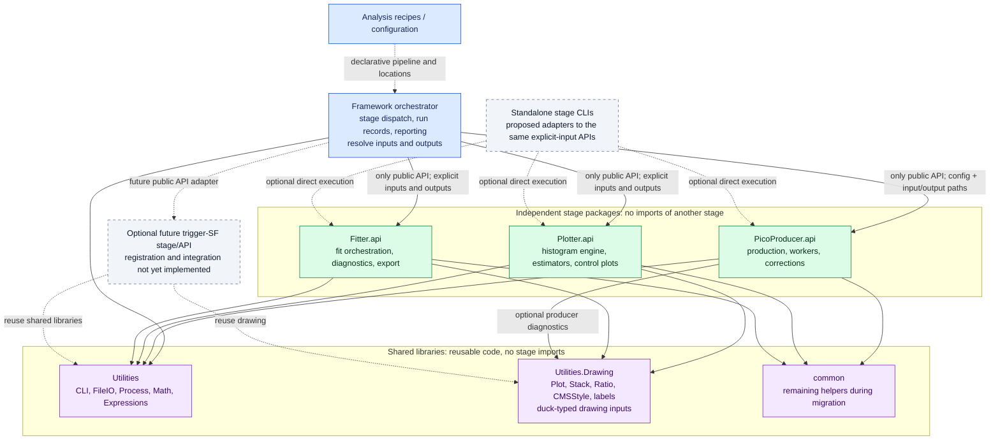

# TauFW dependencies: before the refactor and the isolation target

**Before:** stages import each other's internals, discover inputs through global state, and combine histogram filling, drawing and fitting. **Target:** the Framework wires independent stages through explicit inputs and outputs; reusable code lives in shared libraries.

The old graph uses **`0b174cf8122899bfbe5e5f03378d27e2d5c932fa`**, the parent of `949ce56` (Test Migration 1, 12 October 2026). This is the repository you started refactoring, including code subsequently deleted or archived. It is not today's partially cleaned checkout.

The target follows [07-module-isolation.md](../../../LocalR/architecture/07-module-isolation.md), especially sections 2, 3, 6 and 7. That local note is Git-ignored; the decisions needed to read these graphs are restated here. **The target is a design, not a claim that isolation is already implemented.** Manifests, schema ownership and standalone CLI policy remain proposals in that note.

## 1. Old repository: coupled stages and hidden handoffs

The graphs show repository code modules, imports and calls. Data artifacts, physics objects, external runtimes and process-state objects are omitted. Labels retain the configuration lookups and side effects that make modules coupled. Red nodes expose mixed responsibilities. The full evidence inventory still records external imports and data conventions.



**The stage-level import graph is `PicoProducer ↔ Plotter`, with `Fitter → Plotter`.** The dependency cycle exists at package level even though some imports are delayed or conditional. The old tree has no Framework package to own the handoffs.

| Old stage dependency | Qualified `TauFW.*` records | Path-based records | Total records | Caller files |
|---|---:|---:|---:|---:|
| Fitter → Plotter | 67 | 10 | **77** | 34 |
| PicoProducer → Plotter | 10 | 0 | **10** | 6 |
| Plotter → PicoProducer | 2 | 0 | **2** | 1 |
| Total | 79 | 10 | **89** | **41** |

These counts include Python 2, auxiliary, data-directory and subsequently archived/deleted source files; embedded tests are counted separately. One qualified Fitter import names the missing `TauFW.Plotter.plot.datacard`. Ten bare catalog imports use explicit `sys.path` hints or unique repository candidates; their runtime resolution remains CWD/import-path dependent. Counts are source import records, not imported symbols, unique dependency pairs, executed calls, or an estimate of mandatory runtime dependencies. The latest boundary check's smaller non-legacy scope is not an apples-to-apples baseline.

There are also **149 non-test wildcard import records**. Exact/script-local file imports form three strongly connected groups: **15 Plotter files**, **11 PicoProducer infrastructure files**, and **2 common logger/table files**. This measures mutually reachable static dependencies, including function imports; it does not assert that every cycle causes an import-time crash.

## 2. Proposed architecture: the Framework owns wiring

Solid arrows below are allowed code/API dependencies. Dotted arrows mark declarative configuration or proposed adapters. **There are no code-dependency arrows between stage packages.** Data exchange is described in the supporting text rather than drawn as extra nodes.



The Framework chooses **where artifacts go and which stage receives them**. Stage implementations still perform their own low-level ROOT/file operations at the supplied paths, using shared IO helpers. Passing files or an agreed input description does not require importing the package that produced them. Data artifacts and runtime objects are intentionally absent from these module diagrams.

Histogram filling, including `createinputs*`, normalization, selections, background estimates and shape generation, belongs to **Plotter/histogramming**. Fitter starts from histogram inputs. Drawing belongs to **Utilities.Drawing**, so Fitter can draw postfit diagnostics without importing Plotter. A genuine producer diagnostic may use the drawing library directly; comparison workflows that are really plotting should leave PicoProducer. Generic multiprocessing belongs to Utilities.Process.

`common` is allowed during migration. ROOT/RDF adapters specific to histogram computation belong inside Plotter; process-wide ROOT initialization should become explicit. Sample lists, luminosity and process colors should be supplied as analysis data rather than recovered from another stage or a style module. Moving drawing code alone does not implement these later cleanup steps.

## What each old dependency becomes

Every detected import site is in the appendix; this table also names the less visible dependency mechanisms that an import-only picture would miss. Historical paths below refer to the pinned baseline, not today's renamed files. Locate every matching source line in [old-evidence.md](dependencies/old-evidence.md).

| Old coupling / dependency mechanism | Historical evidence | Intended boundary |
|---|---|---|
| Producer validation needs a plotting package for multiprocessing | `PicoProducer/python/storage/utils.py:161,195` → `Plotter.plot.MultiThread` | Utilities.Process, callable from any stage |
| Optional producer diagnostics import drawing | `analysis/StitchEffs.py:109-110`, `GenFilterMuTau.py:457`, `data/pileup/getPileupProfiles.py:34` | Shared drawing library; preserve distinction between optional diagnostics and mandatory production |
| Comparison tools import Plotter's `Variable` through `Plot` | `PicoProducer/utils/compareNano.py:10,12`, `comparePico.py:7,9` | Move plotting workflow out of production or use independent drawing inputs |
| Plotter discovers producer's global configuration | `Plotter/python/sample/utils.py:38,125` → `PicoProducer.tools.config.getconfig()` | Explicit tuple paths/input description supplied by Framework |
| Input files guessed from folder and naming substitutions | `sample/utils.py:31-41,114-127`; `$PICODIR/$SAMPLE_$CHANNEL$TAG.root` | Explicit artifact identities and metadata; manifest mechanism still proposed |
| Reading config can create directories, repair and write JSON | `PicoProducer/python/tools/config.py:getconfig` | Resolved per-run configuration; persistence handled deliberately by the config adapter |
| Import changes CWD and initializes global config | `PicoProducer/python/pico/common.py:6-7` | Explicit entry-point initialization; no import-driven workflow mutation |
| Host/user names choose paths and scheduler backends | `tools/config.py:getdefaultconfig`, `storage/utils.py:guess_sedir/guess_tmpdirs`, `batch/utils.py` | Explicit resolved backend/site settings in production inputs |
| Config ↔ storage ↔ sample ↔ batch circular dependency | 11-file component in the exact import graph | Separate configuration, dataset identity, execution state and adapters |
| Producer catalogs and channels are loaded by strings | `storage/utils.py:97`, `analysis/utils.py:ensuremodule`, `pico/run.py:getmodule` | Explicit module-local selection/registration; loader behavior is part of the API |
| Writers depend on a live analysis object and mutable branch arrays | `analysis/TreeProducer.py:__init__/addBranch`; channel-specific writers read `module` flags; analysis fills `self.out.*` | Explicit writer/schema options and resource ownership within PicoProducer |
| Correction constructors depend on payload layout and external tools | `PicoProducer/python/corrections/*`; `datadir`, ROOT/CSV/JSON files, TauPOG/HTT tools | Declared correction inputs within producer; external dependencies remain visible |
| Fitter imports Plotter configuration through relative `sys.path` | Ten `config.samples*` imports; e.g. `Fitter/tutorial/createinputs.py:6-7` and `TauES/createinputsTES.py:7,9` | Analysis data/recipe plus Plotter histogram API; remove executable cross-stage catalog imports |
| Fitter is a histogrammer as well as a fitter | `Fitter/python/plot/datacard.py:114` calls `sampleset.gethists`; `createinputs*` configures observables and variations | Shape production moves to Plotter; Fitter receives shapes |
| Fitter rendering, logging, IO and strings arrive through Plotter re-exports | `datacard.py:10-13`; postfit/scans/rebinning and `Zpt/config/samples.py:3-4` | Drawing, expressions, logging and file helpers from their actual shared homes |
| Missing or unresolved namespaces masquerade as interfaces | `Fitter/MuTauFR/createinputs.py:11`; trigger scripts' `TauFW.TriggerSF.Common.*`; JetToTauFR's `TauFW.Plotter.config.samples` | Repair/remove callers or register an explicit package; do not invent a working dependency in the graph |
| Plotter classes and helpers form circular re-export chains | `sample/utils.py:640-643`, `Sample.py:4`, `SampleSet.py:6`; full 15-file component in appendix | Explicit imports and split sample, selection, filling and drawing responsibilities |
| Physics normalization and display share mutable era/lumi state | `sample/utils.py:setera`; `Sample.py:65`; `CMSStyle.lumi_dict` | Explicit analysis/normalization context, separate drawing context |
| Constructing sample metadata also opens ROOT files | `Plotter/python/sample/Sample.py:__init__/setnevents` | Make metadata and materialized file resources explicit within histogramming |
| Selection syntax silently depends on pico branch names and variation suffixes | `plot/Variable.py`, `Selection.py`, `string.py`, sample configs | Document tree/branch/variation contracts; supplied selections remain data-coupled |
| Event normalization depends on histogram names and bin numbers | `Sample.py:57-65`: `tree`, `cutflow`, raw-event and sum-weight bins; producer cutflow definitions | Explicit normalization metadata/contract; preserve physics semantics |
| Importing a named estimator mutates a class | `SampleSet.py:288`; `methods/QCD_OSSS.py:112`; archived fake-rate and scale-variation methods | Explicit module-local estimator registration; no import-order dependence |
| Imports alter shared ROOT runtime behavior | `plot/utils.py:18,22,27-28`; `Plot.py`; `common/tools/RDataFrame.py` declarations and RDF patches | Explicit ROOT/runtime initialization and ownership |
| Logger and table depend on one another | `common/python/tools/log.py:189`, `Table.py:107` | Shared CLI/table implementation with a clear dependency direction |
| Shape files, cards and workspaces are connected by string conventions | `Fitter/python/plot/datacard.py:createinputs`; `TauES_ID/harvestDatacards_zmm.py:86`; harvesters | Declared shape/card schemas and explicit artifact locations |
| Fit orchestration invokes tools through command strings | `TauES_ID/makecombinedfitTES_SF.py:93,95,100` and many later `os.system` sites; all shell workflows in appendix | Checked process execution behind Fitter API; recipes own pipeline variants |
| CWD and relative output folders connect scripts and runs | `Fitter/run_inputs*.sh`, `run_workflow*.sh`, `Plotter/plot.py`, numerous `output_*`/`plots/` paths | Framework supplies run-specific input/output directories |
| Trigger workflow depends on pico schema without a stage import | `Tau_Trigger_SF/TriggerSF_tools/createTurnOn_multi.py:73`: `RDataFrame('tree', input_file)`, trigger/WP/DM expressions | Explicit input contract; optional future Framework adapter, not claimed to exist |
| Calibration outputs feed later corrections through ROOT/JSON names | Fitter export scripts, trigger converters and producer correction payload loaders | Explicit calibration schema/provenance; artifact coupling remains, code coupling does not |

External requirements are not architectural failures by themselves. The old inventory includes **all** explicit imports of ROOT, NumPy, SciPy, matplotlib, uproot, correctionlib, Coffea, NanoAODTools, TauPOG, CombineHarvester, HiggsAnalysis, CMSSW packages, Python standard-library modules and the smaller optional modules. It also retains native includes, batch templates, all non-comment shell statements, command strings, file/payload references and environment assumptions. These do not disappear simply because stages become isolated.

## Full detail, including the small dependencies

The readable old graph groups related nodes. The supporting files retain the detail that would make that diagram unreadable:

- [Historical evidence, every import and every matched non-import site](dependencies/old-evidence.md): expandable Markdown tables, all 89 stage-crossing import sites, unresolved/ambiguous names, all cycle members and all parse limitations.
- [Complete old repository file/module graph](dependencies/old-full-graph.mmd): every Python file and its repository-module dependencies, including tests and unresolved `TauFW.*` imports; caller → module edges retain source line numbers. External-runtime and standard-library nodes are omitted; their imports remain in the evidence tables. Dotted provider links mean inferred/ambiguous resolution. This large graph may exceed default Mermaid renderer limits; the two diagrams above stay compact.
- [The same complete old graph in Graphviz DOT](dependencies/old-full-graph.dot): for graph viewers that handle large graphs without Mermaid's default limits.
- [All old Python import records](dependencies/old-imports.csv): **2,466** records across **405** Python files, preserving imported symbols, aliases, wildcards, function/conditional context and resolution status. **2,251** records are outside embedded tests.
- [Other dependency evidence](dependencies/old-other-evidence.csv): **10,046 matching source lines**, with mechanism labels. These are review evidence, **not 10,046 proven dependencies**; textual matches can include non-executed strings or inline comments.
- [Scanned text files](dependencies/old-source-files.csv): **552** source/config/template/payload files, with no legacy/data/auxiliary directory exclusions.
- [Every old tracked path](dependencies/old-tracked-files.csv): **783** paths, including binary ROOT payloads and documentation. Binary file contents are not interpreted as code.
- [Reproducible documentation audit](dependencies/audit_old.py): standard-library-only scanner that reads the pinned Git tree and writes only these documentation artifacts.

43 Python files fail full-file parsing under Python 3; their imports are still recovered instead of dropping those files from the graph. An existing unclosed expression in `PicoProducer/test/testSample.py` produces one explicit tokenizer EOF warning; recovered imports and the limitation are recorded. Dynamic runtime imports, installation-specific aliases, generated paths and complete branch-expression semantics cannot be proven exhaustive by a static scan.

To regenerate the evidence without importing or executing production code:

```powershell
python Docs/Develop/Refactor-2025/dependencies/audit_old.py
```

The target for inter-stage code imports is **zero**. The Framework's imports of the exact public stage APIs and ordinary shared-library/external dependencies remain allowed. The task creates documentation only and does not implement any of these production changes.
