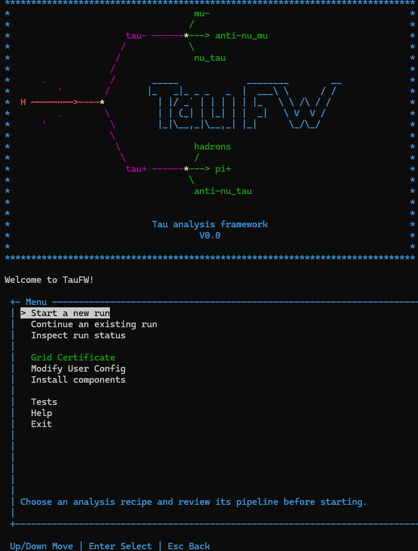

# Your first session

**You need:** TauFW installed with [FastSetup](../FastSetup.md)

Nothing on this page submits jobs or writes anything big. You can't break anything here, so go ahead and try.

## Getting in

Log in to lxplus and go to your TauFW folder. FastSetup put it inside the CMSSW release:

```bash
cd ~/CMSSW_14_1_0_pre4/src/TauFW
source taufw.sh
```

You do this every time you open a new terminal. The first `source taufw.sh` installed everything. From now on it
just sets up the environment (it runs `cmsenv` for you) and opens the TauFW menu. It's quick.

It also gives your terminal the command `taufw`. Left the menu? Type `taufw` to open it again, from any folder.
`taufw --help` lists the commands behind the menu ([Using the Framework with commands](../4-Concepts/UsingFWWithCommands.md)).
If you'd rather not see the menu every time, set `open_menu_on_start: false` in your
[user config](UserConfig.md).

## The menu

When the menu opens, you'll see something like this:



Use the arrow keys to move, Enter to pick something and Esc to go back. Here's what's there:

- **Start a new run**: pick a recipe from `Analyses/`, see its stages, and start it.
- **Continue an existing run**: pick a run you started earlier and push it forward.
- **Inspect run status**: see where a run is, without changing anything.
- **Tests**: run TauFW's automated tests.
- **Grid Certificate**: check your grid proxy, or make a new one.
- **Modify User Config**: edit your personal settings. F2 saves; Esc goes back.
- **Help**: short answers to common questions.
- **Exit**: leave the menu.

### First thing: your grid proxy

Look at **Grid Certificate**. A green tick means your proxy is fine. A yellow warning means it's missing or expired.

PicoProducer needs a valid proxy to ask DAS which files belong to a sample and to read files from remote storage.
Without one, production fails in confusing ways. So if you see the warning, select **Grid Certificate** and type
your grid certificate password. It's passed straight to `voms-proxy-init` and isn't saved anywhere.

A proxy lasts a limited time, so it's worth glancing at the tick every time you start working.

### Look at the recipes

Pick **Start a new run**. Don't worry, it doesn't start anything until you confirm.

On the left you'll see the recipes in `Analyses/`. On the right is the selected recipe's pipeline: its stages, top
to bottom, in the order they'll run. Move up and down through the list and watch the right side change.

The examples have their own list: select **[Examples]**, just above Back. They live in `Analyses/Examples/`, so your
own analyses don't get lost among them. One example, `broken`, is shown in red. That's on purpose. It's full of
mistakes, so you can see what TauFW does with a broken recipe. Select it and the problems are listed above its
stages.

For commands, recipe checks, and detailed plan examples, see
[Using FW with commands](../4-Concepts/UsingFWWithCommands.md).

## What's next

You've seen the menu and looked through the example recipes. In [Tutorial 1](../2-Tutorials/01-FirstProduction.md) you'll
run this same recipe for real and get your first pico tuples.
